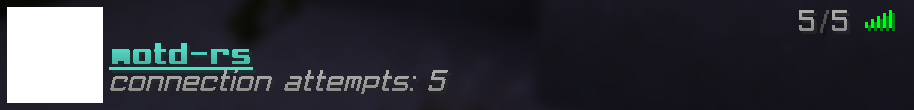

# motd-rs



A small minecraft java status server with a configurable motd, icon, and disconnect message.

---

```sh
cp assets/config.example.json assets/config.json
# edit assets/config.json to customize the server
docker compose up --build
```

---

- `version_display` defaults to `compatible`. set it to `label` to advertise `version_name` with protocol `-1`.
- use `{attempt}` in `version_name`, `motd`, `sample`, or `disconnect`. use `{player}` in `disconnect`.
- `color` accepts named colors like `gray` and hex values like `#5AD9C8` (1.16+ for hex).
