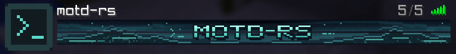

# motd-rs

> _A tiny, self-hosted Minecraft Java status server in Rust._



Customize the server-list message, icon, and disconnect screen. Login attempts are counted and displayed in the server list.

## Run

```sh
cp assets/config.example.json assets/config.json
docker compose up --build
```

## Configure

Edit `assets/config.json`, copied from the [example](assets/config.example.json). The first configured MOTD for the client version is used.

| Version        | MOTD fields in priority order           |
| -------------- | --------------------------------------- |
| Before 1.21.9  | `motd`                                  |
| 1.21.9–1.21.11 | `motd_banner` → `motd_sprites` → `motd` |
| 26.1+          | `motd_sprites` → `motd`                 |

Use `atlas` and `sprite` in `motd_sprites`. In `motd_banner`, use `player.name` for a player head or a Base64 `textures` property in `player.properties` for a custom skin. Build image banners with 8×8 tiles and `\n` between rows. [Text components](https://feedback.minecraft.net/hc/en-us/articles/39966147272589-Minecraft-Java-Edition-1-21-9-The-Copper-Age) · [ImageMOTD tile generator](https://github.com/tgb20/ImageMOTD)

Use a named color or `#RRGGBB` for `color`, and a packed ARGB integer or an RGBA array for `shadow_color`. [Color formats](https://feedback.minecraft.net/hc/en-us/articles/31477609902477-Minecraft-Java-Edition-Snapshot-24w44a)

Use `{attempt}` in messages, player samples, or the version label, and `{player}` in `disconnect`. Set `version_display` to `label` to show `version_name` with Minecraft's incompatibility marker.
